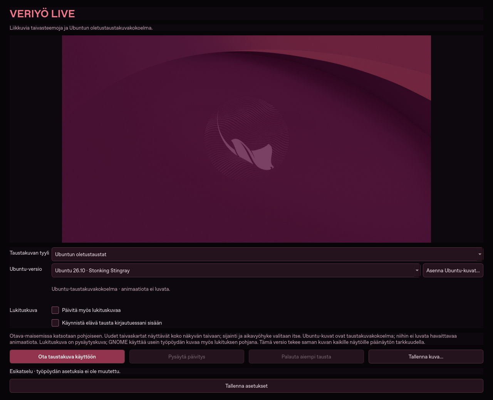

# Veriyö Live

**Elävä Otavan tähtitaustakuva Windowsille ja Ubuntu GNOME:lle.**
Maisema pysyy paikallaan, Otava seuraa oikeaa tähtitaivasta. Mukana Veri Ajan
777 päivän ajanlasku, joka perustuu paikalliseen Suomen aikaan.

**[Lataa uusin julkaisu](https://github.com/Jakke77/Veriyo-Live/releases/latest)** ·
[Julkaisut](https://github.com/Jakke77/Veriyo-Live/releases) ·
[Ilmoita ongelmasta](https://github.com/Jakke77/Veriyo-Live/issues)


## Versio 0.2.1

Windowsin hylkäämä lukituskuva ei enää pysäytä työpöytätaustaa tai Ubuntu-kuvien
live-liikettä. Sovellus näyttää lyhyen ilmoituksen ja jatkaa työpöydän päivittämistä.
Lukituskuvaa ei yritetä uudelleen jokaisella päivityksellä. Myös lukituskuvan
varmuuskopioinnin epäonnistuessa työpöytä toimii; lukituskuvaa ei silloin muuteta.
Vanhan 0.2.0-version epäonnistuneesta vaihdosta voi jatkaa poistamalla
**Päivitä myös lukituskuvaa** -valinnan; aiempi varmuuskopio säilyy palautusta varten.

Oma taustakuvasovellus Windows 10/11:lle ja Ubuntu GNOME:lle. Maisema pysyy paikallaan,
seitsemän oikeaa Otavan tähteä liikkuu antamasi paikan tähtitaivaan mukana.
Ohjelma toimii kokonaan ilman verkkoyhteyttä ja ilman Ajanlaskut ja Sää -asennusta.

## Ubuntu live -paketti · 45 versiota



[Katso 48 sekunnin liike-esimerkki: Ubuntu 22.04](screenshots/ubuntu-22.04-live-demo.mp4)

1. Lataa julkaisuista sovelluksen lisäksi **Ubuntu-Live-Pack-1.0.0.zip**.
2. Avaa Veriyö Live ja valitse **Taustakuvan tyyli → Ubuntun oletustaustat**.
3. Paina **Asenna live-paketti…** ja valitse ladattu ZIP. Paketti tarkistetaan ja asennetaan paikallisesti.
4. Valitse erillisestä **Ubuntu-versio**-valikosta haluamasi kuva ja paina **Ota elävä tausta käyttöön**.

Mukana ovat kaikki artikkelin 45 Ubuntu-versiota 4.10–26.10. Versioilla 14.04
ja 14.10 on sama alkuperäinen tausta, ja molemmat löytyvät valikosta. Eläinhahmot
hengittävät tai keinuvat hyvin vähän, meduusan lonkerot aaltoilevat ja abstraktit
muodot virtaavat hitaasti. Kuvaan lisätään vain muutaman pikselin paikallista
liikettä; 48 sekunnin silmukka jatkuu saumattomasti. Alkuperäiset värit säilyvät.
Ubuntu-kuvien päällä ei näy Otavaa, kalenteria tai koordinaatteja.

Voit vaihtaa **Ubuntu-versiota myös taustan ollessa käytössä**. Valinta tallentuu
ja vaihtaa kohtauksen. Muihin taustatyyleihin vaihdettaessa pysäytä päivitys ensin.
Paketti toimii asennuksen jälkeen ilman verkkoyhteyttä. Sovelluksen perusasennus
pysyy pienenä: live-kuvat asennetaan erilliseen `packs`-kansioon sovelluksen tietojen alle.

Ubuntu GNOME käyttää omaa XML-taustakuvasiirtymää: lisäosaa, videotoistinta tai
jatkuvaa levyyn kirjoittamista ei tarvita. Windows käyttää Explorerin WorkerW-
pintaan sijoitettua hiirtä ja näppäimistöä kaappaamatonta taustapintaa, joka
piirtää rauhallisia siirtymiä 10 kertaa sekunnissa ja taukoaa lukituksen ajaksi.
Windowsin näkyvä WorkerW-tuki riippuu Explorer-istunnosta; jos pinta ei ole
saatavilla, ohjelma jättää pysäytyskuvan ja näyttää syyn. Molemmissa käyttöjärjestelmissä
**Pysäytä päivitys** pysäyttää liikkeen kuvaan ja **Palauta aiempi tausta** palauttaa varmuuskopion.
Lukitusnäyttöön valmistellaan pysäytyskuva, ei jatkuvaa animaatiota.

Kuvien alkuperäiset tekijämerkinnät ja lisenssitiedot ovat lisäpaketin
`LICENSES`-kansiossa. [Alkuperäiskuvien artikkeli](https://www.spacebar.news/ubuntu-linux-default-wallpapers/).
Tämä on itsenäinen fanisovitus, ei Canonicalin virallinen live-taustapaketti.
Lisäksi julkaisuissa on alkuperäiskuvat ja lähdetiedot sisältävä ZIP kehitystä varten.

## Käyttö

1. Avaa **Veriyö Live** sovellusvalikosta (Ubuntu) tai **Veriyo-Live.exe** puretusta Windows-kansiosta.
2. Valitse **Otava ja järvi** tai **Hiillos**. Oletuspaikka on **65.071562, 25.507046**.
3. Kokeile halutessasi **Nopeutettu esikatselu**. Se ei muuta työpöytää tai vientikuvan aikaa.
4. Paina **Ota elävä tausta käyttöön**. Kuva päivittyy oletuksena minuutin välein.
5. Valitse **Päivämäärä**: **Piilossa**, **Veri Aika**, **Tavallinen päivämäärä** tai **Molemmat**. Valinta tallentuu heti ja päivittää myös käynnissä olevan taustakuvan.
6. **Pysäytä päivitys** jättää viimeisen kuvan. **Palauta aiempi tausta** palauttaa varmuuskopion.

Päivämäärän **Piilossa**-valinta poistaa kaikki päivämäärät ja kellonajan taustakuvasta; koordinaatit jäävät alareunaan. **Tavallinen päivämäärä** näyttää gregoriaanisen päivämäärän ja kellonajan Suomen ajassa. Esikatselun aikaleima sovelluksen sisällä säilyy näkyvissä. Vanhan version päivämäärävalinta säilytetään päivityksessä.

Otava käyttää oikeaa tähtiaikaa: yksi kierros kestää noin **23 h 56 min**. Veri Ajan
vuosi on erillinen 777 paikallisen päivän ajanlasku, joka alkaa 26.6.2026 klo
01:07:07 Suomen aikaa; uusi päivä ja viikko vaihtuvat klo 01:07:07 myös kesä-/talviajassa.
Otavaa ei keinotekoisesti nopeuteta 777 päivän kalenteriin. Liike näyttää myös oikean vuodenajan.

Kuva katsoo pohjoiseen stereografisessa projektiossa. **Länsi on vasemmalla, itä oikealla,
zeniitti ylhäällä.** Pohjoisen taivaannavan korkeus on havaintopaikan leveysaste,
oletuksena 65,071562°. Horisonttiviiva on havainnollinen; kuvan metsä ei mallinna
Oulun oikeaa maastoa. Alkaid, hännän viimeinen tähti, on ympyröity. Vain seitsemän
ohjelmalla piirrettyä tähteä edustavat laskettua taivasta; pohjakuvan sumut ja muut tähdet ovat kuvitusta.

## Ubuntu

Asenna ladattu paketti:

```bash
sudo apt install ./veriyo-live_0.2.1_all.deb
```

Sovellus löytyy nimellä **Veriyö Live**. Komento: `veriyo-live`.
Taustan vaihtaminen tarvitsee kirjautuneen GNOME-istunnon (Wayland tai X11).
KDE/Xfce eivät kuulu tähän ensimmäiseen versioon; kuvan tallennusta voi käyttää niissäkin.
GNOME käyttää yleensä työpöytäkuvan sumennettua versiota myös lukituksessa.
Valinnainen erillinen lukituskuva-asetus toimii vain, jos GNOME-versio tukee sitä;
aktiivinen Dia Wall 77 tai toinen taustakuvaohjelma voi ohittaa tämän kuvan.
Pidä vain yksi taustakuvaa vaihtava ohjelma kerrallaan käytössä.

## Windows

Pura **koko ZIP** pysyvään kansioon. Avaa **Veriyo-Live.exe**.
Pythonia tai järjestelmänvalvojan oikeuksia ei tarvita. **Luo-pikakuvakkeet.cmd**
tekee pikakuvakkeet vain tämän käyttäjän työpöydälle ja Käynnistä-valikkoon.
**Tarkista-toiminta.cmd** ajaa mukana tulevat testit muuttamatta taustakuvaa.

Veriyö-kuvien päivitys käyttää Windowsin omaa taustakuvatoimintoa; Ubuntu live -kuvien liike käyttää yllä kuvattua WorkerW-pintaa. Lukituskuvan
vaihto käyttää käyttäjäkohtaista Windows WinRT -toimintoa, jos Windows sallii sen.
Ennen ensimmäistä vaihtoa sovellus yrittää tallentaa nykyisen lukituskuvan; jos
varmuuskopiointi ei onnistu, vaihtoa ei tehdä. Spotlight- tai diaesitysvalintaa
sovellus ei voi palauttaa kuvatiedostosta: valitse se tarvittaessa Windowsin omista
**Mukauttaminen → Lukitusnäyttö** -asetuksista. Yrityskäytäntöjä ei ohiteta.
Jos Windows hylkää automaattisen vaihdon, käytä **Tallenna kuva…** -painiketta ja
valitse kuva itse kohdassa **Asetukset → Mukauttaminen → Lukitusnäyttö → Kuva**.
Tämä ei estä työpöytätaustan toimintaa. Jos aiemman lukituskuvan palautuskin
hylätään, työpöytä palautetaan ja lukituskuvan varmuuskopio säilytetään myöhempää
palautusyritystä varten.

## Lukitusnäytön ja live-kuvan rajat

**Veriyö-taivaskuvat** ovat ajastetusti päivittyviä taustakuvia. **Ubuntu live -kuvat** käyttävät jatkuvaa rauhallista siirtymää. Tähtien todellinen hidas liike ei tarvitse videotoistoa.
Veriyö-esikatselu päivittyy normaalisti kerran sekunnissa ja nopeutettuna 10 kertaa sekunnissa; Veriyö-työpöytä päivittyy 1, 5 tai 26 minuutin välein. Ubuntu live -esikatselu ja Windowsin taustapinta päivittyvät 10 kertaa sekunnissa; GNOME käyttää omaa sulavaa taustakuvasiirtymäänsä.
Kumpikaan käyttöjärjestelmä ei takaa, että **jo näkyvissä oleva lukitusnäyttö**
lataa kuvan uudelleen. Sitä ei väitetä jatkuvasti animoiduksi. Tietokoneen
nukkuessa ei tehdä päivityksiä; herätessä asento korjataan.

Kaikki näytöt saavat saman kuvan päänäytön tarkkuudella. Erilliset näyttökohtaiset
sommittelut, vapaa sijaintialue ja sujuva videotausta voidaan tehdä myöhemmin.
Otavan taivasnäkymän sijainti on rajattu leveysasteille 60–70° N. Ubuntu-kuvien liike ei riipu sijainnista. Tähtimalli tukee vuosia 1900–2100.

## Taustalla käyttö ja palautus

Valitse **Käynnistä elävä tausta kirjautuessani sisään** ja tallenna asetukset.
Suljettu ikkuna jää ilmoitusalueelle, kun tausta on käytössä ja ilmoitusalue on saatavilla.
Ilman ilmoitusaluetta ikkuna pidetään näkyvillä taustakäynnistyksessä. Ilmoitusalueen
**Lopeta** lopettaa sovelluksen jättäen viimeisen kuvan; palautuspainike on erillinen.

Aiempi tausta tallentuu ennen ensimmäistä muutosta ja säilyy myös ohjelman tai
koneen uudelleenkäynnistyksen yli. Käynnistys jatkaa samaa varmuuskopiota eikä
korvaa sitä omalla kuvallaan. Jos vaihdat työpöytäkuvaa muualla, palautus säilyttää
sen ja uusi automaattinen ajo pyytää ensin palautustoiminnon käyttöä. Lukituskuvan
valinnan muuttaminen kesken varmuuskopion vaatii ensin palautuksen.

Windowsissa ZIP-kansion siirron tai uuden version jälkeen avaa uusi sovellus ja
paina **Tallenna asetukset**; kirjautumiskäynnistyksen polku päivittyy tähän kansioon.
Asennuksen poisto ei poista henkilökohtaisia asetuksia tai varmuuskopiota. Palauta
aiempi tausta ja poista kirjautumiskäynnistys käytöstä ennen poistamista.

Tiedot ovat erillään Ajanlaskut ja Sää -asetuksista:

- Ubuntu: `~/.local/share/veriyo-live/` (tai XDG_DATA_HOME).
- Windows: `%LOCALAPPDATA%\VeriyoLive\`.

Veriyö-päivitykset käyttävät kahta vaihtuvaa JPEG-kuvaa. Ubuntu live -paketti sisältää ennalta lasketut avainkuvat; se ei kirjoita uusia kuvia levylle jatkuvasti. Päivitykset eivät kasvata kuva-arkistoa loputtomasti. Viimeisin kuvatiedosto säilytetään lopetettaessa.

## Lähdekoodista ja kuvan viennistä

```bash
python3 -m venv .venv
.venv/bin/pip install -r requirements.txt
.venv/bin/python main.py
QT_QPA_PLATFORM=offscreen .venv/bin/python main.py --self-test
QT_QPA_PLATFORM=offscreen .venv/bin/python main.py --export veriyo.png --at 2026-10-27T21:00:00+02:00 --size 3840x2160
```

Windowsissa vastaavat komennot käyttävät `.venv\Scripts\python.exe`-ohjelmaa.
Jos ajat lähdekoodia ilman Windowsin mukana tulevaa tzdataa, asenna myös `pip install tzdata`.

## Päivitys versiosta 0.1.0

Windowsissa lopeta vanha Veriyö Live ilmoitusalueen **Lopeta**-valinnalla ja pura uusi ZIP omaan pysyvään kansioonsa. Avaa uusi **Veriyo-Live.exe**. Jos kirjautumiskäynnistys on valittu, paina uudessa versiossa **Tallenna asetukset**, jotta polku osoittaa uuteen kansioon. Ubuntu-paketti päivittää aiemman asennuksen; sulje vanha ohjelma ja avaa päivitetty sovellus.

## Tarkistukset

Tähtimallin tuloksia verrataan riippumattomaan Astropy/ERFA-aineistoon. Testit
kattavat päivärajan, DST:n, koko vuorokauden geometrian, molemmat kuvat,
päivityksen, pysäytyksen, uudelleenkäynnistyksen ja keskeytyneen muutoksen palautuksen.
Qt-käyttöliittymä ja pakattu Windows-ajoympäristö tarkistetaan erikseen.
Pilviympäristössä ei ole käyttäjän oikeaa Ubuntu- tai Windows-lukitusnäyttöä:
niiden näkyvä käyttäytyminen tarvitsee vielä kokeilun omalla koneella.


## Kehitys ja paketointi

Tämä repo on itsenäinen: tarvitut PyMeeus-lähdekoodit ja lisenssit sisältyvät
`vendor`-hakemistoon. Koko Ajanlaskut ja Sää -sovellusta ei tarvita.

```bash
python3 packaging/build.py ubuntu --output outputs/ubuntu
```

Windowsin rakentaja tarvitsee `packaging/downloads.json`-tiedoston tarkisteita
vastaavat ladatut riippuvuudet ja Zig 0.15.2:n. GitHub Actions tekee latauksen,
tarkistaa tarkisteet ja rakentaa paketit automaattisesti. Se ei pakkaa mukaan
henkilökohtaisia asetuksia, taustakuvan varmuuskopioita tai sovelluksen tietoja.

Päivityksen yhteydessä muuta `veriyo_live/__init__.py`-versionumero ja
`packaging/launcher.rc`-versionumerot. `main`-haaran päivitys ajaa testit ja
rakentaa paketit ladattaviksi Actionsin artefakteista. Version mukaisen tagin
(esimerkiksi `v0.2.1`) julkaisu rakentaa molemmat käyttöjärjestelmäpaketit ja
julkaisee ne yhdessä lähde-ZIP:n ja SHA256-tarkisteiden kanssa. Julkaisua ei
tehdä, jos kumman tahansa käyttöjärjestelmän tarkistus epäonnistuu.

## Lisenssit ja alkuperä

Oma ohjelmakoodi: [MIT](LICENSE). Riippuvuuksien ja kuvituksen ehdot sekä
tekijämerkinnät: [THIRD_PARTY_NOTICES.md](THIRD_PARTY_NOTICES.md).
Julkinen repo ei muuta kolmansien osapuolten tai taustakuvien lisenssiehtoja.
[Projektin alkuperä](docs/ALKUPERA.md).


### Ubuntu-kuvien lähderakennus

`tools/build_ubuntu_pack.py` hakee alkuperäiskuvat manifestin osoitteista,
tarkistaa niiden SHA256-arvot ja tuottaa paikallisesti muodonmuutetut avainkuvat.
Alkuperäisiä hahmoja ei maalata uudelleen. Rakennustyökalut tarvitsevat NumPyn ja
Pillow'n; sovelluksen käyttö ei tarvitse niitä. GitHub Actions rakentaa ja tarkistaa
lisäpaketin erikseen ja liittää sen julkaisuun.

Kokoelma sisältää **lisäpaketin version 1.0.0**. Alkuperäiskuvien ZIP on kehitysaineistoa;
asennuspainikkeesta valitaan nimenomaan **Ubuntu-Live-Pack-1.0.0.zip**.
